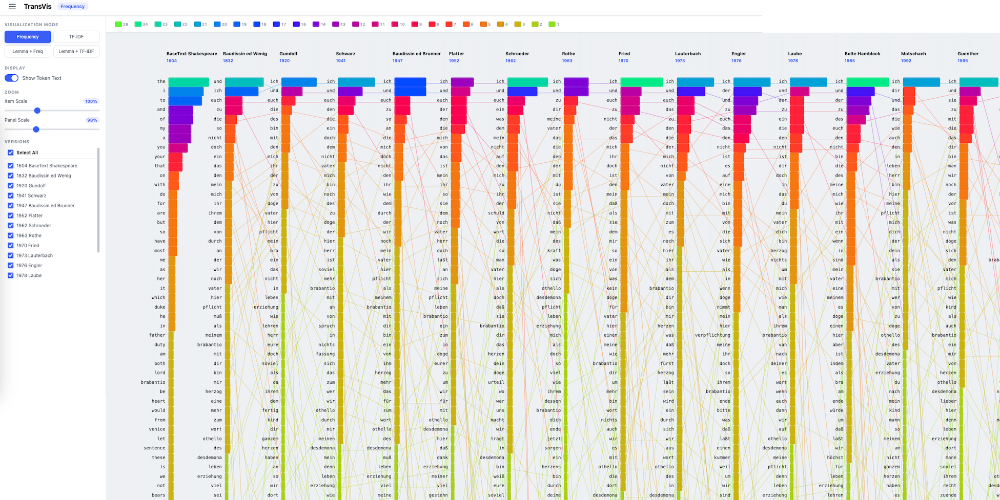

# TransVis

**Translation Visualization** — compare how vocabulary shifts across multiple German translations of Shakespeare's *Othello*, aligned against the 1604 English base text.

[](https://xiaoxiao-liu.github.io/transVis/)

**[Try the live demo →](https://xiaoxiao-liu.github.io/transVis/)**

## Overview

TransVis displays token-level differences between translation versions as parallel columns. Colored bars encode frequency or TF-IDF weight; connecting lines trace the same token across versions so you can see persistence, reordering, and lexical change at a glance.

The corpus includes the **1604 English base text** and **15 German translations** (1832–2003).

## Features

| Mode | Description |
|------|-------------|
| **Frequency** | Most frequent tokens per version |
| **TF-IDF** | Distinctive tokens by TF-IDF weight |
| **Lemma + Freq** | Top German lemmas by frequency |
| **Lemma + TF-IDF** | Distinctive lemmas by TF-IDF |

**Interactive controls**

- Switch among the four visualization modes
- Show or hide token labels on the canvas
- Toggle individual translation versions on/off
- Zoom item scale and panel scale independently
- Hover and click to highlight tokens across versions

## Project structure

```
transVis/
├── docs/              # Static site for GitHub Pages (live demo)
├── transvis-web/      # Web frontend source
├── flask_app/         # Data precomputation & optional local server
├── ShakesVis/         # Original Java desktop application (Eclipse)
└── transvis.png       # Screenshot for documentation
```

## Run locally

### Option 1: Static site (recommended)

Precomputed JSON lives under `docs/data/`. Serve the `docs/` folder with any static file server:

```bash
cd docs
python3 -m http.server 8080
```

Open [http://localhost:8080](http://localhost:8080).

### Option 2: Flask

```bash
cd flask_app
pip install -r requirements.txt
python precompute.py    # regenerate JSON from source texts (optional)
python app.py           # http://localhost:5000
```

### Regenerate visualization data

Source texts are in `ShakesVis/ShakesVis/src/data/`. To rebuild the JSON files used by the web app:

```bash
cd flask_app
python precompute.py
# copies output to docs/data/ when deploying to GitHub Pages
cp static/data/*.json ../docs/data/
```

## Original desktop app (Java)

The first implementation is a Java Swing application under `ShakesVis/`. Open the Eclipse project and run `translationVisualization.MainMethod` to launch the desktop GUI. Lemma processing uses Stanford CoreNLP (bundled under `ShakesVis/.../APIs/`).

## Translation versions

| Year | Translator / edition |
|------|----------------------|
| 1604 | BaseText Shakespeare (English) |
| 1832 | Baudissin ed Wenig |
| 1920 | Gundolf |
| 1941 | Schwarz |
| 1947 | Baudissin ed Brunner |
| 1952 | Flatter |
| 1962 | Schroeder |
| 1963 | Rothe |
| 1970 | Fried |
| 1973 | Lauterbach |
| 1976 | Engler |
| 1978 | Laube |
| 1985 | Bolte Hamblock |
| 1992 | Motschach |
| 1995 | Guenther |
| 2003 | Zaimoglu |

## License

See bundled third-party licenses (e.g. Stanford CoreNLP) under `ShakesVis/ShakesVis/src/APIs/`.
